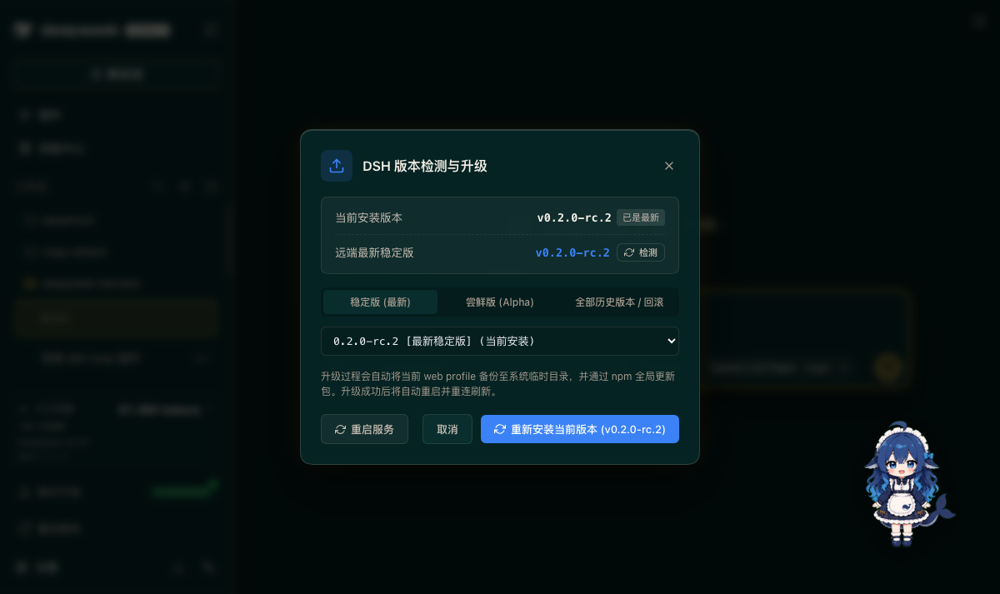
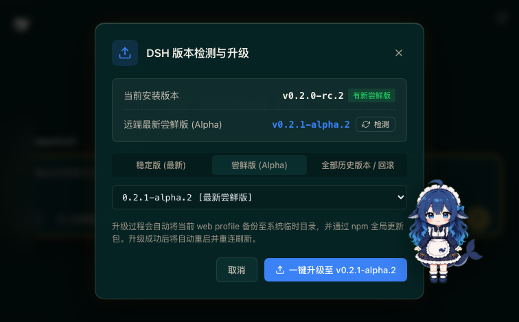
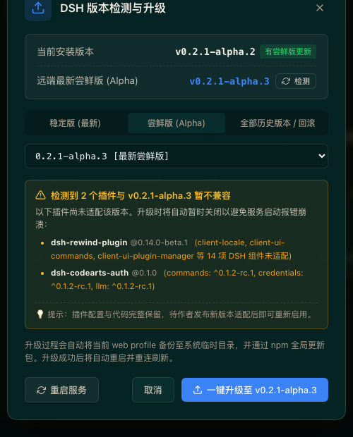
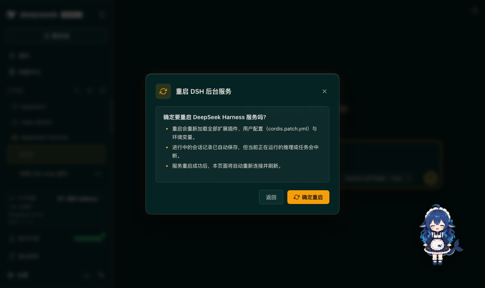

# dsh-upgrade 🚀

> 专为 **DeepSeek Harness (DSH)** 打造的一站式版本检测、多通道平滑升级与服务守护插件。

[](https://www.npmjs.com/package/dsh-upgrade)
[](https://www.npmjs.com/package/dsh-upgrade)
[](https://npmmirror.com/package/dsh-upgrade)
[](LICENSE)
[](https://github.com/deepseek-ai/deepseek-harness)
[](#)

---

## ✨ 核心特性

- 🎯 **精准多源版本比对**：自动对比本地当前安装的 `@deepseek-ai/dsh` 与远端最新版本（优先使用国内 npmmirror 镜像源加速，自动降级至官方 npmjs 源）。
- 🏷️ **多通道智能分流**：
  - **稳定版通道 (Latest)**：推荐日常使用，有稳定新版本时提示蓝色徽章 `[有新版本]`。
  - **尝鲜版通道 (Alpha)**：率先体验新特性（如 `0.2.1-alpha.x`），有新预览版本时提示绿色徽章 `[有尝鲜版更新]`。
  - **全部历史 / 一键回滚**：支持浏览并自由回滚到任意历史版本。
- 🛡️ **升级前自动快照备份**：每次执行升级前，自动将当前用户的 `~/.dsh/profiles/web` 打包备份至系统临时目录（`.tgz`），确保随时可安全还原。
- ⚠️ **智能插件兼容性预检与安全防护**：
  - 升级前自动分析当前安装插件的 peerDependencies 与 DSH 版本要求；
  - 弹窗内直观列出哪些插件尚未适配目标 DSH 版本及其冲突依赖；
  - **升级时自动将不兼容插件从启动列表暂时关闭**（完整保留用户配置与代码），彻底杜绝新版本服务因旧插件报错或崩溃无法启动；
  - 待插件作者发布新版本适配后，即可无缝重新开启。
- 🔄 **深度整合服务重启**：弹窗内内置 **「重启服务」** 按钮，带有安全二次确认与影响说明，一键触发后台服务重启并重新加载插件与配置。
- ⚡ **零中断心跳探测与自动重连**：重启或升级后，前端自动进行无感心跳轮询探测，服务恢复就绪后自动平滑刷新页面，无需手动干预。
- 🎨 **无缝现代深色 UI**：完美融入 DSH 侧边栏底部工具栏（`sidebar.footer.action`），自带呼吸感提示圆点与状态胶囊。

---

## 📸 界面预览

| 稳定版通道（支持重装与重启） | 尝鲜版通道（检测 Alpha 预览） |
| :---: | :---: |
|  |  |

| 插件兼容性预检与自动防护 | 二次确认安全面板 |
| :---: | :---: |
|  |  |

---

## 📦 安装与使用

本插件已公开发布至 **npm 全球注册表** 与 **国内 npmmirror 镜像源**，支持通过 DSH Web 界面或命令行极简安装。

### 方式一：在 DSH Web 界面中添加（推荐，最简便）

1. 打开 DeepSeek Harness 网页端（如 `http://127.0.0.1:3080`）。
2. 点击左侧边栏底部的 **设置 ➔ 插件管理 ➔ 添加插件**。
3. 在包名输入框中直接填入 npm 包名：
   ```text
   dsh-upgrade
   ```
4. 点击 **安装**，安装成功后重启后台服务即可生效！

---

### 方式二：通过 CLI 命令行安装

在终端执行官方 DSH 插件添加命令：

```bash
# 从 npm 官方或国内镜像源直接安装（推荐）
dsh plugin --profile web add dsh-upgrade

# 或者直接从 GitHub 仓库源安装
dsh plugin --profile web add github:wonaren/dsh-upgrade
```

#### 生效与重启服务
安装完成后，执行 launchctl 命令重启后台服务（或直接在插件内点击重启）：

```bash
launchctl kickstart -k gui/$(id -u)/com.deepseek.dsh.web
```

---

## 📁 目录结构

```text
dsh-upgrade/
├── package.json        # 插件元数据与 DSH bundle 声明 (已发布至 npm)
├── cordis.patch.yml    # Cordis 补丁层配置
├── LICENSE             # MIT 开源协议
├── README.md           # 插件说明文档
├── lib/
│   ├── index.js        # Host 端服务：版本查询、npm 升级与服务重启执行器
│   └── client.js       # Client 端 UI：React 弹窗、侧边栏入口与心跳重连
└── screenshots/        # 实机效果预览截图
```

---

## 🔗 相关链接

- **npm Package**: [https://www.npmjs.com/package/dsh-upgrade](https://www.npmjs.com/package/dsh-upgrade)
- **npmmirror 镜像**: [https://npmmirror.com/package/dsh-upgrade](https://npmmirror.com/package/dsh-upgrade)
- **GitHub 源码仓库**: [https://github.com/wonaren/dsh-upgrade](https://github.com/wonaren/dsh-upgrade)

---

## 📄 开源协议

本项目基于 [MIT 协议](LICENSE) 开源。
